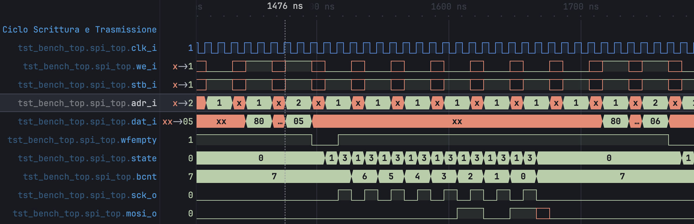
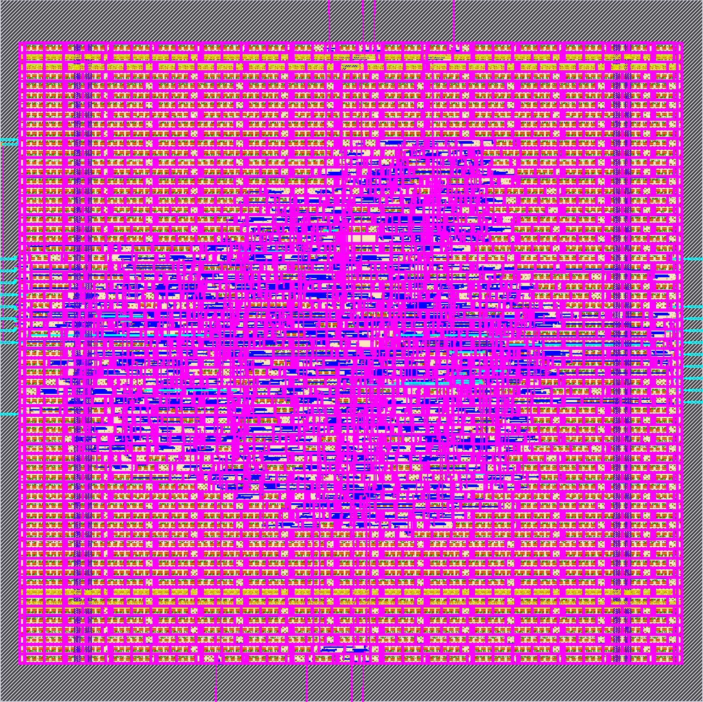
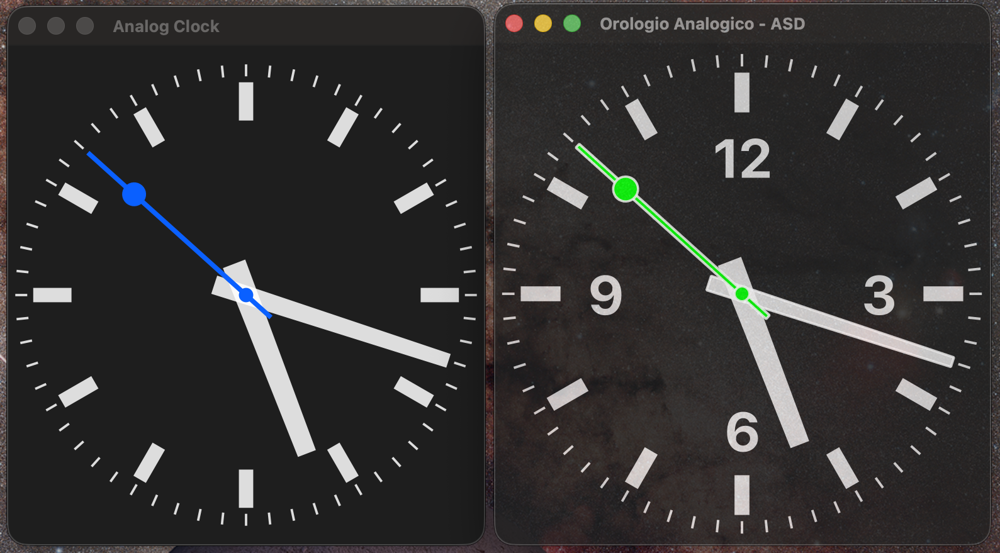

# Architetture dei Sistemi Digitali: Homework

Due homework per il corso di Architetture dei Sistemi Digitali. Il primo copre il flusso di progettazione hardware, dal Verilog al layout fisico. Il secondo copre la modellazione software di sistemi complessi, con interfacce grafiche desktop e mobile e un sistema federato in Lingua Franca.

[](#homework-1-dal-verilog-al-gdsii)
[](#homework-1-dal-verilog-al-gdsii)
[](#homework-2-qt-android-e-lingua-franca)
[](#homework-2-qt-android-e-lingua-franca)

La relazione completa (in italiano) è disponibile su richiesta.

## Homework 1: dal Verilog al GDSII

Il progetto di partenza è il core [simple_spi](https://opencores.org/projects/simple_spi) di OpenCores. È un controller SPI master con interfaccia Wishbone e FIFO di profondità 4 in trasmissione e in ricezione.

**Parte A: simulazione RTL** ([homework_spi/](homework_spi/), [HW1_A_Verilog/](HW1_A_Verilog/))

- Simulazione del core con Icarus Verilog e analisi delle forme d'onda.
- Verifica delle quattro modalità SPI (CPOL/CPHA) e della riconfigurazione a runtime.
- Porting del testbench per l'esecuzione su macOS.



**Parte B: sintesi fisica** ([HW1_B_LibreLane/](HW1_B_LibreLane/), [spi_layout/](spi_layout/))

- Flusso RTL-to-GDSII con LibreLane (OpenLane 2) su PDK `sky130A`, eseguito in Docker perché l'host è Apple Silicon.
- Il design passa le verifiche DRC, LVS e antenna.
- Analisi del layout con KLayout.



Confronto tra due esecuzioni dello stesso design, cambiando solo `CLOCK_PERIOD` in [config.json](HW1_B_LibreLane/config.json):

| Metrica | 50 MHz (20 ns) | 100 MHz (10 ns) |
| --- | --- | --- |
| Slack (WNS) | +14.35 ns | +4.38 ns |
| Potenza totale | 0.97 mW | 1.90 mW |
| Celle | 1093 | 1090 |
| Diodi d'antenna | 1 | 0 |

Il percorso critico è di circa 5.6 ns, quindi il core potrebbe arrivare a circa 180 MHz in Sky130.

### Eseguire la simulazione

```bash
brew install icarus-verilog
cd homework_spi
iverilog -o spi_sim.vvp tst_bench_top.v simple_spi_top.v fifo4.v \
  spi_slave_model.v wb_master_model.v
vvp spi_sim.vvp
```

Il testbench scrive la traccia in `waveform.vcd`, che si apre con GTKWave o con un viewer VCD.

> [!NOTE]
> L'elenco esatto dei file da compilare e le opzioni usate sono nella relazione, sezione Homework 1.

### Eseguire la sintesi

Con LibreLane installato (o nel suo container Docker):

```bash
cd HW1_B_LibreLane
librelane config.json
```

## Homework 2: Qt, Android e Lingua Franca

**Parte A: Qt/C++** ([analogclock/](analogclock/), [analogclock_mod/](analogclock_mod/))

Parte dall'esempio *Analog Clock* della documentazione Qt 6. La versione modificata fa quattro cose:

- ha un nuovo titolo di finestra;
- ha una finestra semitrasparente (opacità 85%);
- ha lancette ridisegnate, con la lancetta dei secondi verde;
- mostra i numeri 12, 3, 6 e 9 sul quadrante.

A sinistra l'originale, a destra la versione modificata:



```bash
brew install qt cmake
cd analogclock_mod
cmake -B build && cmake --build build
open build/analogclock.app
```

**Parte B: Android** (Kotlin e Jetpack Compose)

Modifica di un modello di esempio con Jetpack Compose. Il progetto Android Studio non è in questa repository. Descrizione e screenshot sono nella relazione.

**Parte C: Lingua Franca** ([lf-demos/](lf-demos/))

Parte da `Probe1.lf`, dalla categoria *network-monitor* di [lf-demos](https://github.com/lf-lang/lf-demos). È un sistema federato a coordinazione decentralizzata che misura la latenza di rete ed espone i dati via WebSocket. Le modifiche sono due:

- il periodo di campionamento passa da 1 s a 250 ms;
- la topologia passa da 2 nodi a un anello di 3 nodi (`p1 → p2 → p3 → p1`), con un server di monitoraggio per nodo sulle porte 8080-8082.

```bash
brew install libwebsockets libmicrohttpd
lfc src/Probe1.lf
```

## Struttura della repository

| Cartella | Contenuto |
| --- | --- |
| `homework_spi/`, `HW1_A_Verilog/` | Sorgenti Verilog, testbench e forme d'onda |
| `HW1_B_LibreLane/`, `spi_layout/` | Configurazione LibreLane, log, metriche e GDSII |
| `analogclock/`, `analogclock_mod/` | Esempio Qt originale e versione modificata |
| `lf-demos/` | Copia di [lf-lang/lf-demos](https://github.com/lf-lang/lf-demos), con le mie modifiche |
| `docs/images/` | Immagini usate in questo README |

> [!NOTE]
> `systemc-3.0.2/` e `lf-demos/` sono codice di terze parti, ognuno con la propria licenza.

## Strumenti

Icarus Verilog, LibreLane/OpenLane 2, KLayout, Docker, Qt 6, CMake, Android Studio, Lingua Franca, LaTeX.
